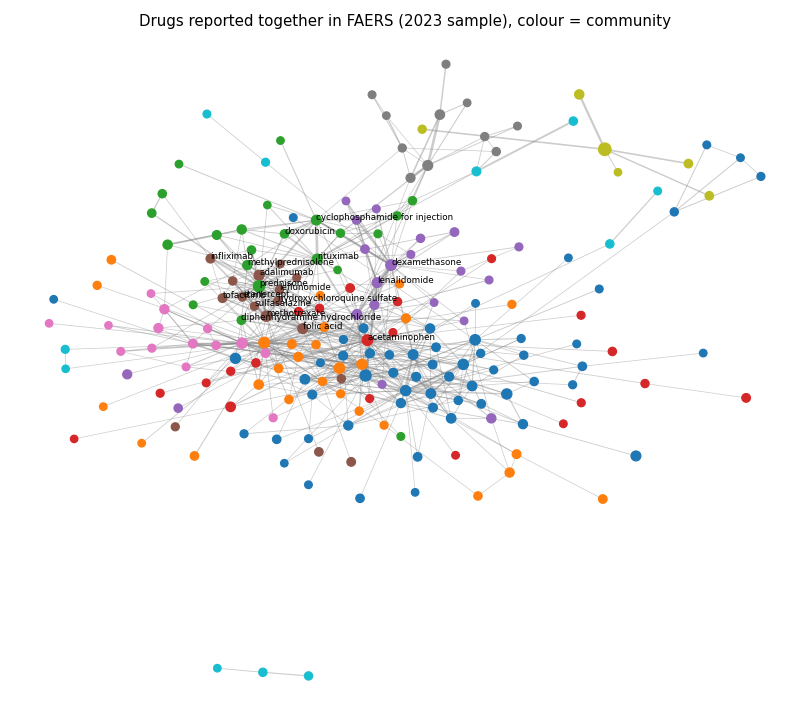
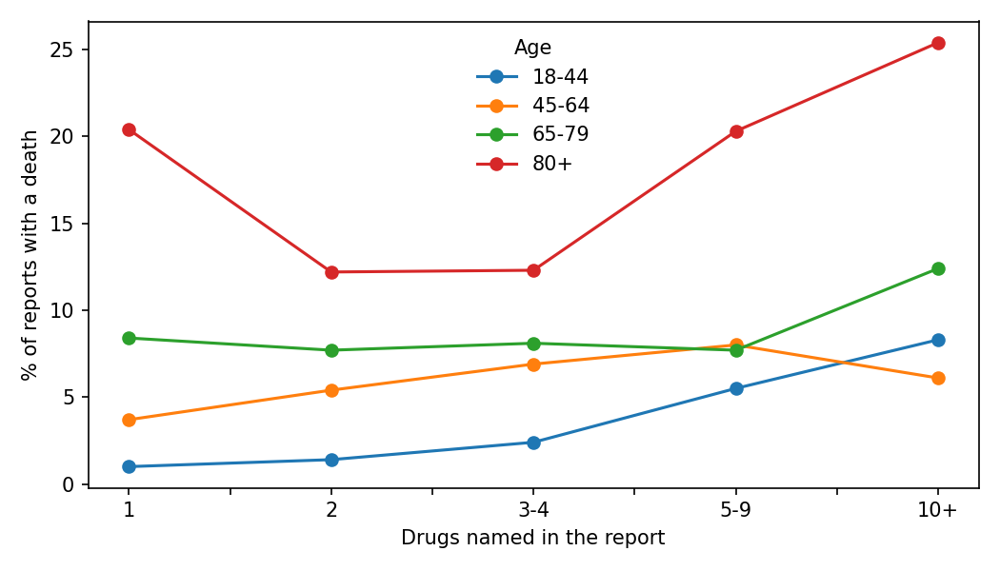

# Which drugs show up together? A network of FAERS adverse event reports

Patients often take many drugs, and adverse event reports list them together. I built a network from 15,000 FAERS reports (adults, 2023) where two drugs are linked if they appear in the same report. Then I looked for communities, central drugs, and whether reports with more drugs involve more deaths. Network code (centrality, community detection, layout) is written from scratch in numpy.

## Data

FDA Adverse Event Reporting System through openFDA (https://open.fda.gov/apis/drug/event/). `src/fetch.py` pulls the first 15,000 adult reports received in 2023 that have at least one drug with a generic name, 100 per call. Drug names are the openFDA generic names. The report file is not stored here, run the script to rebuild it. Result tables are in `data/`.

Of those, 5,597 reports name two or more drugs. The network uses only those, and only drugs that appear in at least 25 of them (256 drugs).

## What I found

- Strong pairs by lift (how much more often two drugs appear together than chance, at least 20 joint reports): pertuzumab + trastuzumab (lift 104), azacitidine + venetoclax (63), macitentan + treprostinil (57), tadalafil + treprostinil (50), letrozole + palbociclib (36), mesalamine + vedolizumab (34), insulin glargine + insulin lispro (33). These are real regimens, which is a good sign the method works.
- Most common pairs are cancer and immune regimens: dexamethasone + lenalidomide (92 reports), prednisone + rituximab (78), carboplatin + paclitaxel (77), folic acid + methotrexate (68).
- Communities (label propagation, best of 20 runs by modularity, 0.55): breast and solid-tumour chemotherapy; myeloma and blood cancers (dexamethasone, lenalidomide, bortezomib, daratumumab); transplant and immunosuppression (prednisone, tacrolimus, mycophenolate); rheumatology (methotrexate, adalimumab, tofacitinib); asthma and allergy (albuterol, montelukast); pulmonary hypertension (treprostinil, sildenafil, macitentan); a heart and metabolic group (aspirin, metformin, apixaban, furosemide). See `data/communities.csv`.
- Most connected drugs by eigenvector centrality: prednisone, rituximab, methotrexate, cyclophosphamide, folic acid. They are the "hub" drugs in many regimens.
- Reports with more drugs have more deaths: 4.8% with one named drug, 8.7% with 5 to 9, 10.9% with 10 or more. But age drives most of this. Within age bands the pattern is not clean (for example 80+ with a single drug is 20.4%), so I would not read this as "more drugs cause more deaths".




## Limits

- FAERS is voluntary reporting. Reports are biased towards serious events and towards drugs in the news or in lawsuits. One example in this sample is the copper IUD, which has thousands of single-drug reports.
- Co-reported does not mean interacting. Two drugs together in a report often just means the patient takes both.
- Only drugs with an openFDA generic name are counted, so unnamed products and some supplements are missing. About two thirds of the reports name only one drug and do not enter the network.
- A sample of 15,000 reports (the first the API returns), not all of 2023.
- The network picture is a hairball. The tables carry the findings.

## Run it

```
pip install numpy pandas requests matplotlib
S=0 E=5000 python src/fetch.py
S=5000 E=10000 python src/fetch.py
S=10000 E=15000 python src/fetch.py
python src/analyze.py
```
